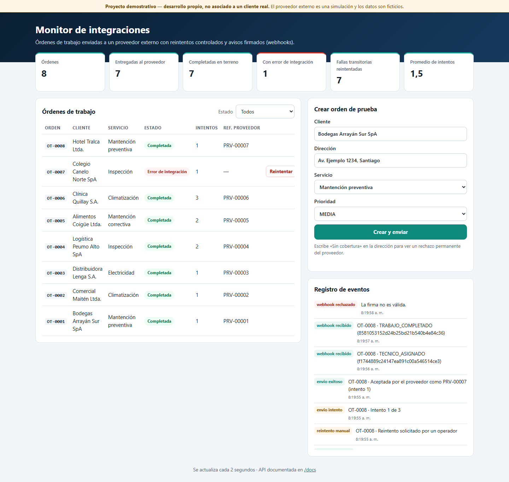
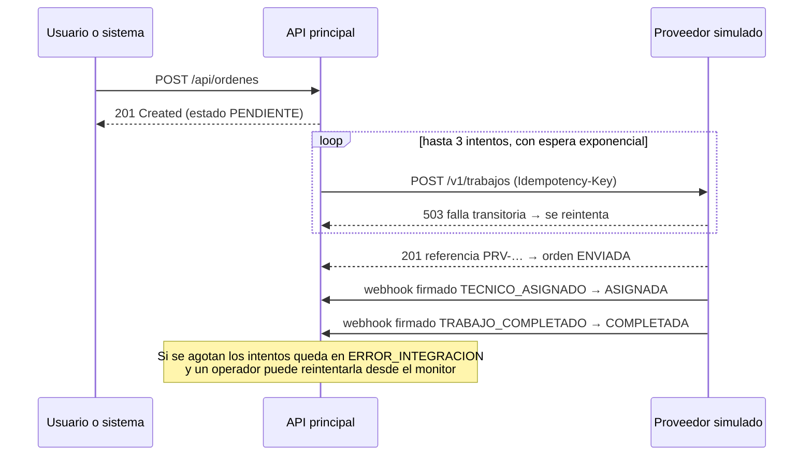
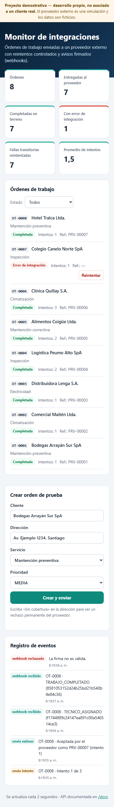
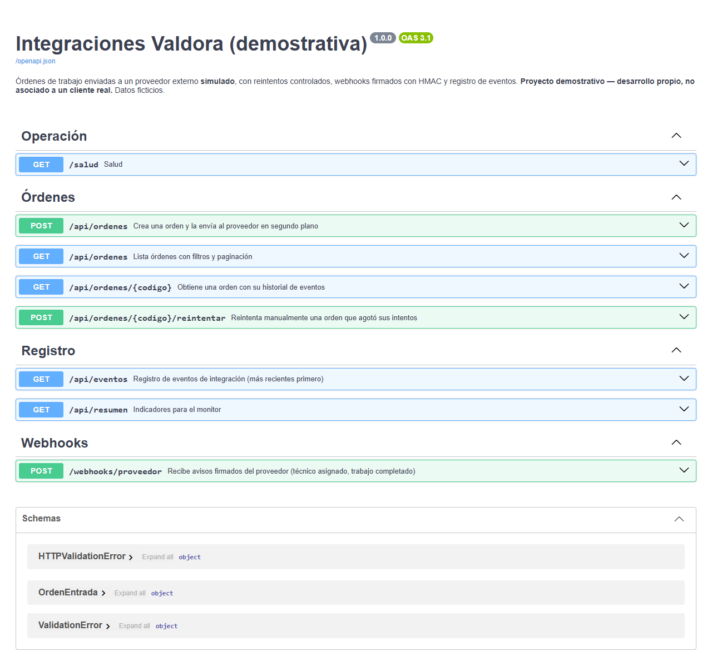

# Integraciones y automatización · órdenes de trabajo con un proveedor externo

> **Proyecto demostrativo — desarrollo propio, no asociado a un cliente real.**
> «Valdora» es una empresa ficticia. El proveedor externo es una **simulación incluida en este repositorio**: no se usan servicios de pago ni credenciales reales.



## Qué problema resuelve

Integrar sistemas no es solo «llamar a una API»: el otro sistema falla, responde lento, rechaza datos o avisa tarde por webhook. Este proyecto muestra una integración **robusta y auditable**: cada orden de trabajo se envía a un proveedor de técnicos en terreno, se reintenta cuando corresponde, recibe avisos firmados y deja un registro completo de lo que pasó.

## Funcionalidades

- **API principal** (FastAPI): crea órdenes, las lista con filtros y paginación, muestra el historial de cada una y permite reintentarlas a mano.
- **Proveedor externo simulado:** acepta trabajos, **falla a propósito** (503) para ejercitar los reintentos, rechaza direcciones «sin cobertura» (422) y luego envía **webhooks firmados**.
- **Reintentos controlados:** espera exponencial con tope y variación (*jitter*). Se distingue entre errores **transitorios** (503, 429, tiempo agotado), que se reintentan, y **permanentes** (4xx), que no.
- **Idempotencia:** cada envío lleva `Idempotency-Key`, para que un reintento no duplique el trabajo. Cada webhook se procesa una sola vez, aunque llegue repetido.
- **Webhooks seguros:** firma HMAC-SHA256 con marca de tiempo. Un aviso sin firma válida o con más de 5 minutos de antigüedad se rechaza (401).
- **Registro de eventos** consultable por API y **logs JSON** de una línea, sin datos personales.
- **Monitor web** con indicadores, órdenes, reintento manual y eventos en vivo.
- **Errores en formato RFC 9457** (`application/problem+json`), con mensajes de validación en español.

## Arquitectura



```text
app/                  API principal (FastAPI + SQLite)
  integracion.py        Cliente del proveedor y reintentos
  firma.py              Firma y verificación HMAC de webhooks
  reintentos.py         Espera exponencial con jitter
  bd.py                 Órdenes, eventos y webhooks recibidos
  main.py               Rutas, errores RFC 9457 y cabeceras de seguridad
  estatico/             Monitor web (HTML, CSS y JS sin dependencias)
proveedor_simulado/   Proveedor externo simulado (otro servicio FastAPI)
tests/                33 pruebas con pytest
scripts/              Demostración con procesos reales y capturas
```

## Cómo ejecutarlo

Requisito: Python 3.11 o superior.

```bash
python -m venv .venv
.venv\Scripts\activate                       # en Linux o macOS: source .venv/bin/activate
pip install -r requirements-dev.txt
cp .env.example .env                         # define un SECRETO_WEBHOOK propio

# Terminal 1: proveedor simulado
uvicorn --factory proveedor_simulado.main:crear_proveedor --port 8202
# Terminal 2: API principal
uvicorn --factory app.main:crear_app --port 8201
```

Monitor en http://localhost:8201 y documentación OpenAPI en http://localhost:8201/docs. Ambos procesos deben compartir el mismo `SECRETO_WEBHOOK` (variable de entorno). Si no está definido, se usa un secreto de desarrollo y queda una advertencia en el log.

**Demostración automática:** `python scripts/demo_capturas.py` levanta ambos servicios y crea 8 órdenes. Fuerza 3 fallas seguidas para OT-0008, reintenta a mano las que agotaron sus intentos y envía un aviso con firma falsa. Al final genera [`docs/ejecucion-demo.md`](docs/ejecucion-demo.md) y las capturas.

Lo que ocurre en todas las ejecuciones:
- OT-0008 agota sus intentos y se recupera con el reintento manual.
- OT-0007 queda rechazada en forma permanente por tener una dirección sin cobertura.
- El aviso con firma falsa se rechaza con 401.
- Las órdenes aceptadas avanzan a «Completada» mediante webhooks reales.

Las demás órdenes pueden necesitar reintentos automáticos, y eso cambia en cada ejecución porque se procesan en paralelo. Las cifras de la ejecución registrada están en [`docs/ejecucion-demo.md`](docs/ejecucion-demo.md).

**Con Docker:** `docker compose up --build` (ver `compose.yaml`). *Incluido, pero no se ejecutó en el entorno donde se verificó el proyecto.*

## Pruebas

```bash
pytest
```

**Resultado verificado: 33 pruebas, 33 aprobadas** (13-11-2026, Python 3.11, FastAPI 0.162.5). Las pruebas usan un **transporte HTTP simulado** (`httpx.MockTransport`) con guiones de respuestas, así que no dependen de la red ni de tiempos de espera reales.

| Archivo | Pruebas | Qué cubre |
|---|---|---|
| `test_firma_y_reintentos.py` | 7 | Firma válida, cuerpo alterado, otro secreto, reenvío antiguo, espera exponencial |
| `test_ordenes.py` | 4 | Creación y envío, validación en español, filtros y paginación, 404 |
| `test_integracion.py` | 6 | Reintentos hasta lograrlo, intentos agotados, rechazo permanente, reintento manual, resumen |
| `test_webhooks.py` | 7 | Avisos válidos, firma inválida, reenvío antiguo, duplicado idempotente, 404, 409, 422 |
| `test_proveedor_simulado.py` | 6 | Idempotencia, sin cobertura, fallas simuladas y forzadas, avisos firmados y entregados |
| `test_monitor.py` | 3 | Monitor, cabeceras de seguridad, OpenAPI y salud |

Advertencia conocida: Starlette 1.x anuncia que su `TestClient` dejará de usar `httpx`. No afecta los resultados.

| Monitor en móvil | Documentación OpenAPI |
|---|---|
|  |  |

## Limitaciones conocidas

- Los envíos se procesan como tareas en segundo plano del mismo proceso. Para volúmenes altos convendría una cola (por ejemplo, RabbitMQ o SQS) y un trabajador separado.
- La API no tiene autenticación de usuarios, porque es una demostración. Los webhooks sí se autentican con firma.
- SQLite sirve para la demostración. En producción, PostgreSQL.

## Licencia y autor

Licencia MIT. Diseño y desarrollo: **Pablo Ortega Rubio** — desarrollo de software, automatización e integraciones · [github.com/PabloOrtegaRB](https://github.com/PabloOrtegaRB)
